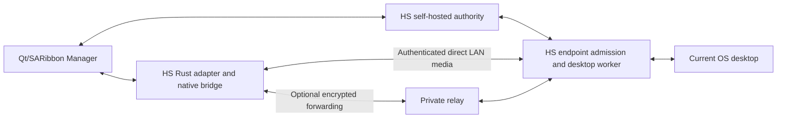

# Historical RustDesk analysis and current remote desktop status

**Current Helicoid core v1 status (21 October 2026).** The [core v1 plan](../plan.md) supersedes the platform and engine-selection assumptions in the historical analysis below. The management app target is the shared Qt/SARibbon application. The currently selected native engine route is [Google WebRTC](../../modules/core/webrtc-native/README.md), with bounded connection-lab evidence only. The organization-owned public edge in [ADR 0007](../adr/0007-native-webrtc-and-public-edge.md) is the current public-network direction; it is not deployed or runtime-accepted. Production capture, endpoint admission, media, and input remain unavailable, and neither full E01 adoption nor the first authorized preview has passed. RustDesk-specific recommendations, gate evidence, and substitution rules below describe the earlier plan and are not the current implementation direction.

Updated on 11 October 2026. Historical status: implementation in progress; engineering gates remained open. Organization-owned RustDesk OSS rendezvous and relay was the selected route at that time; adoption had not passed E01. This document specialized the [system contracts](contracts.md), [workflows](workflows.md), [screen specification](../ui.md), and [build map](build-map.md). Confirmed product decisions remain in [decisions.md](decisions.md). Its original planning work created no implementation. The later RustDesk and WebRTC laboratory evidence does not establish live media or production admission.

## 1. Outcome and scope

An authorized operator opens the shared Qt/SARibbon Manager and automatically sees permitted computer previews. Opening a computer starts a separate view-only window. Take Control explicitly requests exclusive input authority. Several operators can observe independently; one controller owns the computer at a time. The monitored user sees the active identities. Owner or authorized IT can stop control; expiry, revocation, desktop change, permission loss, and process failure also stop it.

Confirmed D24/D25: minimizing releases control while separately authorized viewing stays active; restoration requires explicit Take Control. Overview previews show the current primary display. Detailed windows offer a display picker.

The remote desktop work covers overview previews and detailed observation/control. Screen sharing remains a separate unfinished version 1 package. HS owns accounts, approved management devices, enrolled computer identities, authorization, optional groups, policy, native UI, file jobs, installation, and updates. RustDesk supplies candidate capture, encoding, desktop connection, decoding, and input machinery beneath those contracts. Broader version 1 tools remain in the product plan; completing remote desktop does not complete version 1.

User constraints: shared C++20/Qt Widgets/SARibbon Manager on macOS and Windows; native Swift macOS and WinUI 3 Windows Computer apps; shared Rust machinery; Intel and Apple Silicon Macs; all four Manager/Computer platform combinations; LAN and public internet through organization-owned routing; administrator-installed agents on managed computers; no room/class/lesson model; automatic authorized previews; multiple viewers and one controller; once-approved management computers; open-source licensing compatible with RustDesk; main coordinates separate independently buildable repositories.

Planning assumptions: use C# for the WinUI application boundary; start measurements with the existing Windows 11 x64 and macOS 15-or-newer baselines; use one deployment authority per initial installation. Exact OS/hardware support, product/package identifiers, dependencies, transport format, and measured limits remain proof outputs. These assumptions are not new public support promises.

## 2. Recommended starting architecture

Start with a small maintained RustDesk fork and a product-owned engine adapter. Add a dedicated native build boundary and explicit viewer/endpoint initialization. Reuse proven upstream machinery before deciding whether deeper extraction into libraries is worthwhile. Do not route native callers through RustDesk's application bootstrap or Flutter event interface.

Use organization-owned OSS rendezvous and relay for the selected connection route. Require the expected enrolled peer identity and reject every insecure fallback. Add HS endpoint admission before any capture subscription or input. A failed secure-handshake, exact-channel-binding, endpoint-admission or bounded-relay-allocation gate stops this package; it does not authorize another transport. The ordinary raw-IP RustDesk listener is not our proposed authenticated transport.

RustDesk Server OSS supplies hbbs rendezvous/signaling and hbbr relay. Neither replaces HS account/device/permission authority. RustDesk Pro purchases, vendor accounts and public rendezvous services are not product dependencies. Public connections use the organization-owned services. An organization-owned relay must preserve the same admission contract and have its own forwarding quotas. [Official OSS scope](https://rustdesk.com/docs/en/self-host/rustdesk-server-oss/).

The coordination server carries identity, permissions, presence, policy, grants, interaction ownership, and audit metadata. It does not decode or archive ordinary previews. A selected private rendezvous service supplies routing information. Addresses and upstream peer IDs are locators; they do not become HS identity. Relay and rendezvous must not acquire independent permission to observe computers.

## 3. What the source actually establishes

Research snapshot: [RustDesk 001b0e96173cea4e49f9f7a67bea95a177dd1de3](https://github.com/rustdesk/rustdesk/commit/001b0e96173cea4e49f9f7a67bea95a177dd1de3), inspected on 9 October 2026. The native laboratory pins this exact source; it is not an adopted production dependency or release pin. Later implementation must repeat the critical review against its chosen revision.

| Observed fact | Evidence | Design consequence |
| --- | --- | --- |
| Library outputs exist, but desktop UI dependencies and feature gates remain | [Cargo.toml, line 11](https://github.com/rustdesk/rustdesk/blob/001b0e96173cea4e49f9f7a67bea95a177dd1de3/Cargo.toml#L11), [lib.rs, line 26](https://github.com/rustdesk/rustdesk/blob/001b0e96173cea4e49f9f7a67bea95a177dd1de3/src/lib.rs#L26) | Prove a native build with no required Flutter/Sciter runtime; disabling Flutter alone is insufficient |
| An internal generic Session and handler receive pixels, cursors, display information, status, and close events | [ui_session_interface.rs, line 61](https://github.com/rustdesk/rustdesk/blob/001b0e96173cea4e49f9f7a67bea95a177dd1de3/src/ui_session_interface.rs#L61), [handler, line 1693](https://github.com/rustdesk/rustdesk/blob/001b0e96173cea4e49f9f7a67bea95a177dd1de3/src/ui_session_interface.rs#L1693) | Candidate internal integration seam; private application code, not a supported external SDK |
| An isolated C RGBA export returns an internal pointer; setup and events remain Flutter coupled | [flutter.rs, line 1689](https://github.com/rustdesk/rustdesk/blob/001b0e96173cea4e49f9f7a67bea95a177dd1de3/src/flutter.rs#L1689), [session start, line 1273](https://github.com/rustdesk/rustdesk/blob/001b0e96173cea4e49f9f7a67bea95a177dd1de3/src/flutter.rs#L1273) | A product-owned atomic frame descriptor and lifetime contract are required |
| Ordinary application startup can spawn an endpoint server | [core_main.rs, line 194](https://github.com/rustdesk/rustdesk/blob/001b0e96173cea4e49f9f7a67bea95a177dd1de3/src/core_main.rs#L194) | Viewer initialization cannot call application startup; endpoint hosting is explicit and enrolled |
| Raw direct-IP setup bypasses the selected signed/keyed identity handshake | [client.rs, line 428](https://github.com/rustdesk/rustdesk/blob/001b0e96173cea4e49f9f7a67bea95a177dd1de3/src/client.rs#L428), [direct listener, line 1392](https://github.com/rustdesk/rustdesk/blob/001b0e96173cea4e49f9f7a67bea95a177dd1de3/src/rendezvous_mediator.rs#L1392), [server handshake, line 262](https://github.com/rustdesk/rustdesk/blob/001b0e96173cea4e49f9f7a67bea95a177dd1de3/src/server.rs#L262) | Do not treat connecting to an IP as proof of authenticated encrypted transport |
| Coordinated intranet connections use a different secure path; client code also includes insecure fallback behavior | [rendezvous_mediator.rs, line 810](https://github.com/rustdesk/rustdesk/blob/001b0e96173cea4e49f9f7a67bea95a177dd1de3/src/rendezvous_mediator.rs#L810), [client verification, line 1642](https://github.com/rustdesk/rustdesk/blob/001b0e96173cea4e49f9f7a67bea95a177dd1de3/src/client.rs#L1642) | Mandatory identity verification and fail-closed patches are adoption requirements |
| Encoding distributes through a shared subscriber path; pacing/quality read shared QoS | [video_service.rs, line 1254](https://github.com/rustdesk/rustdesk/blob/001b0e96173cea4e49f9f7a67bea95a177dd1de3/src/server/video_service.rs#L1254), [QoS, line 1444](https://github.com/rustdesk/rustdesk/blob/001b0e96173cea4e49f9f7a67bea95a177dd1de3/src/server/video_service.rs#L1444) | Shared encoding is promising; independent preview/detail behavior needs measurement |
| One capture loop waits for recorded receivers' frame-fetched acknowledgments within a bounded loop | [video_service.rs, line 984](https://github.com/rustdesk/rustdesk/blob/001b0e96173cea4e49f9f7a67bea95a177dd1de3/src/server/video_service.rs#L984) | Test a stalled preview receiver beside an active controller before scaling the grid |
| Upstream authorization includes application permissions and multiple connection modes | [connection.rs, line 1841](https://github.com/rustdesk/rustdesk/blob/001b0e96173cea4e49f9f7a67bea95a177dd1de3/src/server/connection.rs#L1841) | HS authority and removal of unwanted capabilities require endpoint changes |

These are narrow suitability observations. They do not establish an exploitable vulnerability, that all RustDesk traffic is unencrypted, native embedding success, or actual performance. The Stream implementation and complete cryptographic dependency graph were not audited in this planning round.

## 4. Repository and process ownership

Names below describe proposed ownership. They are not newly created repositories, package names, exported symbols, or GitHub URLs.

| Owner | Responsibilities | Consumption and boundary |
| --- | --- | --- |
| main | Plans, ADRs, integration scenarios, exact tested gitlinks and release compatibility manifest | No application implementation |
| apps/manager | Shared Qt/SARibbon Manager UI, C++ wrapper, native rendering/input mapping | Immutable core artifacts with matching headers; independent build on Windows and macOS |
| apps/macos | Swift Computer status UI, Swift wrapper, native rendering/input mapping, signed user-worker and helper integration | Immutable core artifacts with matching headers; independent build |
| apps/windows | WinUI 3 Computer status UI, C# wrapper, native rendering/input mapping, user-worker/service/installer integration | Immutable core artifacts with matching headers; independent build |
| modules/core | Product protocol, authority/lifecycle contracts, RustDesk adapter, public C ABI, generated native artifacts, conformance tests | Owns product semantics; cannot depend on neighboring app checkouts |
| modules/server | Local account/enrollment/access authority, atomic ownership, policy, installation backend, private routing/relay integration | No mandatory screen storage; independently buildable |
| Engine source dependency | Upstream source plus dedicated native handler, feature gates, transport/admission/media patches required by HS | Exact base revision and reviewed patch inventory; a dedicated fork repo is justified only when proof establishes the need |

Only main needs to assemble all app submodules. A core repository may consume an engine fork by an immutable dependency or its own pinned submodule. Do not maintain two independently drifting copies of the same fork. The production source/artifact pinning method is settled during RD01.

The manager engine runs with the manager user's privileges. Endpoint media and input run in the actual signed-in desktop worker. The small privileged helper/service handles typed setup, approved machine actions, and recovery; it does not decode video or expose arbitrary shell. The status UI reports trusted current identities from the worker. Its authenticated liveness participates in the disclosure contract.

Windows services cannot stand in for a signed-in interactive application. Use secured per-session IPC and explicit user-session workers; review caller/session identity and installed binary permissions. [Microsoft service guidance](https://learn.microsoft.com/en-us/windows/win32/services/interactive-services).

On Mac, capture/input permission belongs to the actual signed process performing the operation. Test installed and updated worker identities on both architectures. MDM/PPPC configuration does not justify promising universal silent screen-recording approval. [Apple PPPC guidance](https://support.apple.com/guide/deployment/privacy-preferences-policy-control-payload-dep38df53c2a/web).

## 5. Transport and endpoint admission

### Routing decision to prove

Evaluate two candidates on the same isolated LAN and native bridge:

| Candidate | What is reused | Required change/proof | Selection criterion |
| --- | --- | --- | --- |
| Private OSS rendezvous, coordinated secure path, direct media; organization-owned relay | Existing connection negotiation and media transport | Pin routing identity, require enrolled endpoint key and manager proof, reject missing/invalid identity and downgrade, enforce HS admission everywhere | Prefer initially for retaining upstream machinery if patches remain bounded and host setup is simple |
| Product-authenticated direct adapter feeding engine sessions | Capture/codec/input machinery and selected connection internals | Maintained authenticated transport, channel-to-peer binding, replay protection, bounded framing, no legacy unauthenticated listener | Prefer for shipping only if the reduced routing dependencies outweigh added transport maintenance and security review |

Direct media means pixels travel between authorized peers, even when a private rendezvous service arranged the connection. It does not mean enabling raw-IP direct access. Both candidates must work without public RustDesk infrastructure. An authentication failure may not fall back to a different identity, plaintext, legacy password, or user-approved insecure mode.

Retain only the selected production route. A laboratory comparison is not permission to ship two parallel authentication systems. Protocol, cryptographic libraries, algorithms, certificate/grant formats, nonce rules, skew, and compatibility versions are frozen by RD03 under E03/E07. Do not design a custom cipher.

### Connection sequence

1. The endpoint authenticates to HS using its enrolled key. It reports its actual boot/worker/desktop generations and operation capabilities. This establishes presence, not automatic permission to view.
2. The operator authenticates a local account from the actual once-approved management identity. The server verifies account/manager status, deployment identity, current authorization generation, access revision, and requested computer IDs.
3. Overview demand or a separate detail window requests observation of an exact current computer/display. The server verifies current per-computer observation permission and capability. Included tiles and group names do not confer admission.
4. The server supplies bounded authority and a routing allocation tied to the authenticated account, manager key, endpoint key, current desktop, interaction identity/generation, operation, and expiry. Actual wire fields come from the generated contract.
5. The peers establish the selected authenticated encrypted channel and prove possession of the expected keys. The application proof binds to the verified WebRTC data channel using the sorted SHA-256 digests of both negotiated DTLS certificates, the fixed product-channel label, and its SCTP stream ID. That binding identifies one transport channel; it does not grant product authority. The endpoint verifies HS authority against that channel and current local generations. A valid upstream peer identifier alone is insufficient.
6. The endpoint registers the admitted operator identity with the status UI, verifies the required local capture/disclosure readiness, and only then permits this observer's media subscription. Existing unrelated authorized observers remain independent.
7. Frames and events are accepted only for the current interaction and display generation. A detail window is initially observation-only. No keyboard/mouse packet gains authority merely because the media channel exists.
8. Explicit Take Control requests an atomic server reservation and an endpoint claim. Both use a fenced interaction generation. Controlling appears only after endpoint acknowledgment; a pending or uncertain release keeps the target unavailable to a replacement controller until acknowledgment or safely established expiry.
9. Every remote input event is bound to the active control interaction, current desktop/display layout, generation, and bounded sequence. The endpoint rechecks active control and deadline before applying it. The exact ordering of hub reservation, endpoint claim, cancellation, renewal, and release is tested against races.
10. Renewal requires live account/manager/computer authority, current capabilities, and valid ownership. Duplicate or replayed renewal cannot extend an old deadline. Endpoint local monotonic deadlines bound access when server contact is lost.
11. Teardown immediately blocks new local forwarding, fences the affected interaction, releases its held input, cancels its publication, disposes its images, and reconciles endpoint release. Stop Control preserves separately authorized observation; ending observation clears its pixels. Transport reconnection may obtain fresh view-only admission; it never resurrects control or queued input.

A late grant, packet, frame, release, or callback cannot act on a replacement worker or controller. After hub restore or uncertain authority persistence, change the authorization generation and invalidate old observation, control, and sharing authority rather than trusting stale database state. Block reissue until post-backup revocations have been reconciled through the reviewed recovery procedure. Freeze that complete procedure in RD03/RD10.

### Surface to retain

The initial engine surface is display enumeration, observation, bounded preview/detail demand, cursor state, explicitly admitted input, screen-sharing media, typed status/error, and engine context shutdown. Screenshot acquisition is allowed only through its separate HS capability and workflow. Clipboard starts disabled; future text-only synchronization needs distinct authority and loop prevention.

Remove or make unreachable legacy password login, permissive direct-IP access, public-server fallback, terminal/shell, tunnels/port forwarding, camera/audio, remote printer, upstream arbitrary file browser/transfer, remote restart/elevation shortcuts, privacy/hide-screen modes, recording, uncontrolled resolution changes, and generic raw message/option setters. HS files, power, attention, and other tools use their own typed product contracts. If a needed capability is retained later, it gets a separate proof and permission path.

Audit every reachable initializer, listener, retry, IPC route, URI/command-line path, peer switch, and alternate connection mode. Default-deny unknown connection modes, message families, commands, and options after bounded parsing; a future upstream addition is not implicitly permitted. Hiding controls in the native UI is not removal. Inspect listeners and outbound destinations from a viewer-only process and an installed endpoint. Adversarial callers should get a typed denial before pixels, input, or privileged effects.

## 6. Native bridge contract

This section specifies behavior to implement and test. It does not describe existing RustDesk exports. RD02/RD04 produce the actual public header and generated Swift/C# mappings.

| Concern | Required contract |
| --- | --- |
| Initialization | Explicit viewer or enrolled-endpoint role; version/capability negotiation; no startup side effects outside that role |
| Public values | Opaque handles; fixed-width scalars; bounded structures with sizes/versions; no exposed Rust layouts, String, Vec, Result, or platform-sized display indexes |
| Caller inputs | Copy strings/arrays before returning or explicitly document a retained handle; reject invalid encoding, lengths, enums, geometry, and unsupported versions |
| Operations | Typed initialization, observation, demand/display change, explicit control, input, cancellation, close; no arbitrary engine configuration sender |
| Frames | Immutable owned frame handle with an atomic descriptor and pixels; dimensions, format/color interpretation, stride, byte length, display/layout revision, interaction generation, and sequence validated together |
| Memory | Every engine allocation has its matching release operation; Swift/C# never free it with a different allocator; outstanding frames remain valid until release even after observation close |
| Callbacks | Documented engine queue and ordering; never assume UI thread; bounded delivery; avoid locks while invoking application callbacks |
| Stop/close | Immediately prevent new input/publication and invalidate generations; asynchronous completion drains callbacks/workers for that observation before callback context is freed |
| Frame disposal | Late/rejected frames still release exactly once; live renderer references have independent lifetime; authority loss removes their presentation/export access and releases them as GPU work permits |
| Errors | Stable bounded codes with operation/context/generation; sanitized optional diagnostics; rejected, unavailable, timeout, cancelled, and terminal failure stay distinct |
| ABI failures | No Rust panic or native exception unwinds through C; invalid handles/version mismatches fail predictably; process-level fatal failure triggers lease teardown |
| Shutdown | Observation close is not global engine shutdown; one viewer's close cannot stop another operator; final context shutdown is explicit and bounded |

CPU frame transfer is the first correctness path. Use an owned snapshot rather than separate pointer/size calls against mutable upstream storage. Calculate geometry and allocation sizes with checked arithmetic. Zero-size frames, overflow, impossible stride, oversized decoded buffers, and stale layout/display IDs fail before native rendering.

Swift owns its wrapper's asynchronous lifecycle and dispatches UI updates on MainActor. C# roots delegates/callback context through drained close and dispatches state on the WinUI dispatcher. A handle finalizer is not the normal asynchronous close path. Neither wrapper blocks the UI waiting for an engine thread that might await the UI. Reentrant callback cancellation/close must be covered by the harness.

GPU surfaces are a subsequent negotiated optimization. Define Metal/Direct3D adapter identity, surface ownership, reuse/fence rules, format/color compatibility, and close behavior before passing a GPU handle. Test device loss/reset and a fence that never signals. Clear presentation and reject pending exports immediately on authority loss; safe resource retirement is separate and must not free memory still referenced by GPU work. Bound close waits and define the platform reset/isolated-process recovery path for stuck resources. Measure actual copies and GPU memory. Re-run lifecycle and authority tests; GPU optimization cannot alter privacy or teardown semantics.

## 7. Media demand and backpressure

### Three independent workloads

| Workload | Demand | Required behavior |
| --- | --- | --- |
| Overview preview | Low-resolution low-rate observation of admitted visible computers | Preserve text/desktop readability, aspect ratio, identity and honest freshness; no control |
| Detail/assistance | Chosen display at interactive resolution/rate | Explicit observation before control; stable input/cursor/display mapping; priority over disposable preview work |
| Screen sharing | One authorized source distributed to fixed authorized receivers | Capture/encode once per necessary quality layer, bounded fan-out, per-receiver acknowledgment and independent slow-receiver recovery |

One scheduler owns demand for each current computer desktop/display. Share source capture where the platform permits. Capture only while at least one valid authorized source demand exists; when the final demand ends, stop unnecessary capture/encoding. Maintain the smallest measured set of compatible output renditions. Do not create a full-resolution encoder and decoder for every grid tile, or assume a smaller native view saves source/network work. If upstream sharing forces all observers into one QoS/rendition, measure it and make the necessary isolated rendition patch an explicit task.

Overview inclusion, search/status filtering, action selection, and media demand remain separate. The filtered displayed-ID set defines action targeting; it is not the smaller set of tiles currently visible in the viewport. Proposed scheduling prioritizes viewport-visible previews; a scrolled-off tile retains inventory identity and may retain a labelled cached image only while authorization remains valid and until the stale-clear bound. Revocation, expiry, desktop change, pause, or inclusion removal clears affected overview pixels immediately; stale-clear never extends authority. Grid/List and rendering/rate policies must be frozen during RD06/RD09, while D24 already requires a minimized detail window to keep authorized observation active and release control. A separate remote window keeps its independent observation context when a tile is unchecked. Restoring visible demand acquires fresh authority when required. Pause ends all this console's overview/detail observation and control; other operators remain active.

D25 fixes the overview source to the endpoint's actual current primary display, identified by the current desktop/layout generation. Primary-display changes refresh that source through current authority and discard stale layout frames; an unavailable primary display shows its real capability/readiness state without choosing another display or combining all displays. A detail window's explicit display choice remains independent of the overview source.

Initial scheduler rules to freeze through RD06/RD09:

1. Prioritize teardown/authority processing and control traffic independently of bulk video/file work. Deadlines remain effective even when media queues are full.
2. Bound active streams, capture/encode/decode work, decoded pixels, GPU surfaces, encoded bytes, connection handshakes, pending callbacks, acknowledgment state, and relay bandwidth. Limits are local policy/capability facts, not a client-controlled unlimited request.
3. For decoded/presentable frames, keep a latest-frame slot and bounded upload/in-flight ownership. Replace superseded frames with disposal. Product-owned pools/queues and frame geometry have hard caps. Validate coded lengths/dimensions before decoder allocation; review and test third-party decoder allocation behavior. Where a dependency cannot provide the required bound, establish an observed containment/recovery strategy rather than promising to cap every native/framework allocator.
4. For interframe-coded data, never drop arbitrary packets and continue rendering dependent frames. Use bounded codec-aware queues and a valid reset/keyframe/resynchronization policy. A stalled receiver can lose frames without blocking others.
5. Coalesce receiver progress without accumulating an unbounded acknowledgment per frame. Keep receiver-local backpressure and disconnect/degrade rules. The first mixed test must stall one preview receiver while another operates detail/control.
6. Apply demand/profile changes by generation. Shrinking/removing demand stops unnecessary processing. A preview's preference cannot silently lower another operator's required interactive quality or increase every viewer's decoding cost without an explicit measured scheduling rule.
7. Bound fair scheduling across computers and operators. Opening many details must produce an explicit resource limit or reduction policy, not indefinite memory growth or starvation.
8. Separate presence heartbeat, capture progress, encode progress, delivery, decode, and displayed-frame evidence. A live socket alone does not prove that an unchanged screen is current. Reusing static pixels needs current authority plus an authenticated unchanged-content result tied to that displayed frame/source generation, or a fresh decoded frame. A capture-progress message that could refer to changed content cannot make old pixels current.

Input queue pressure has different semantics from video dropping. Pointer motion may coalesce only without changing button/key ordering or coordinate generation. Never discard individual key/button transitions in a way that leaves remote input held. If the bounded queue cannot preserve input order, stop forwarding, release held input, end the affected control interaction, and report the failure.

Numeric caps, detail-window limits, visible-tile scheduling, stale-clear timing, rendition rules, and overload recovery remain E06 outputs. Product-visible degradation is explicit: lower rate/quality when permitted, then Unavailable with a reason; never stale pixels labelled Live.

## 8. Input and desktop lifecycle

Input uses typed pointer, button, key, modifier, wheel, and committed-text events. Bind coordinates to a proven display layout, including negative origins, rotation, resolution, scaling, and display generation. Reject out-of-bounds/stale mappings instead of applying them on a changed monitor. Apply the [native input ownership contract](contracts.md#local-and-remote-input-ownership): only the explicitly focused foreground remote canvas forwards input; toolbars, menus, dialogs, local fields, pickers, reserved OS/app shortcuts, and other apps stay local. Focus loss stops forwarding and releases injected held input; fullscreen transitions cannot leave remote modifiers held. D27 keeps the endpoint user's physical keyboard/mouse enabled, with no version 1 suppression toggle. Prove overlapping physical/injected events and explicit refocus, rather than assuming the engine's default input routing matches the product.

D26 fixes the target to the computer's physical/primary console under the [session selection contract](contracts.md#os-session-selection). Console plus RDP/background users must select only the eligible console; RDP-only, protected, ambiguous, and attachment-transition states admit no alternate user's desktop. Worker/OS-session-ID reuse still needs a new desktop generation. The engine's first connected user/session is not authority. RD03 proves session binding/denial in the prioritized installed Windows fixture; RD07 completes V40's full installed platform matrix.

Prove Hungarian and US layouts, at least one non-Latin layout, dead keys, AltGr, repeat, modifier chords, IME composition, Unicode text, scroll precision, and multi-monitor scaling. A text event is not an arbitrary shell command. Event sequencing cannot buffer or replay keys after reconnect. Keep held-key/button state and release it on Stop Control, close, focus transition where needed, lease loss, desktop replacement, worker crash, and device sleep.

A crashed worker cannot run its own cleanup. RD03/RD05 must prove a surviving supervisory cleanup/watchdog owner, or a platform mechanism with equivalent observed release, for held input and temporary restrictions. Fence cleanup to the stopped worker/controller generation so a delayed cleanup cannot release a replacement controller's input. Keep that recovery surface typed, session-bound, and independent of screen access. Do not mark crash teardown passed from a normal close callback.

| Event | Mandatory effect | Safe recovery |
| --- | --- | --- |
| Operator closes remote window | Stop its input/observation; clear image; asynchronously drain work | Reopen view-only with fresh context |
| Operator stops control | Stop local forwarding first; request release and reconcile; keep observation only if authorized | Explicit new Take Control |
| Operator minimizes a detail window | Stop local forwarding/release held input; cancel pending admission or release active control; keep authorized observation | Restore view-only; require explicit Take Control after previous release is reconciled |
| Another operator is viewing | Independent observer remains active | No global upstream close caused by one window |
| Controller reservation races | At most one server/endpoint-fenced owner becomes active | Named conflict; no silent takeover |
| Server disconnects | No new admissions/renewals; current authority expires within its frozen bound | Fresh view-only admission after recovery |
| Network, manager, worker, or status UI fails | Stop affected publication/input/disclosure work; clear stale images and release held input | Restart with new generations/authority; no control resume |
| Desktop locks, logs out, changes user, or enters an unsupported protected state | End old desktop authority and caches; input stops | Report current capability; admit only a supported new desktop |
| Mac capture/input permission changes | Stop affected operation and identify missing permission | Local repair followed by fresh admission |
| Endpoint/server identity changes | Deny old channel/grant and show trust error | Authorized identity recovery/enrollment |
| Local clock moves or a grant is replayed | Do not extend the existing monotonic lease | New reviewed admission only |

Initial media/control lease candidate remains at most 30 seconds without valid renewal; it is not a measured guarantee. RD03/RD09 freeze issuance, skew, replay rules, local monotonic conversion, renewal margin, and tested release bound. Pending Release is distinct from acknowledged endpoint stop. Do not grant a replacement controller merely because a local window closed.

Version 1 does not promise remote unlock/login, general pre-login control, elevated/protected-desktop injection, or bypassing OS privacy permissions. Secure-desktop capability gets a dedicated later proof if required. The managed user's UI has no Stop Control command, shortcut, or product API. Normal OS protections and automatic safe teardown remain effective.

## 9. Native screen behavior for this slice

Keep existing screen IDs and layouts in [ui.md](../ui.md). The engine supplies state; it does not add an upstream UI, terminal, codec dashboard, or desktop ID workflow to normal operator screens.

| Surface | Default content and primary actions | Essential states |
| --- | --- | --- |
| Computers | Names and authorized previews; Search; optional Computers panel; Grid/List; restrained action toolbar | Connecting, Live, Paused, Offline, Permission Needed, Unavailable; denied computers never show cached pixels |
| Remote window | Computer name; Viewing or Controlling; Take Control or Stop Control; display picker only when needed | Authorizing, controlled by another named operator, reconnecting view-only, permission loss, ended desktop, Pending Release |
| Endpoint status | Who is viewing and controlling; distinguish roles; local permission/help details | No observer before admitted identity; no student/user stop-control action; multiple identities presented accessibly |
| Sharing | Source and fixed recipient count; Stop Sharing; details for partial results | Preparing, Receiving acknowledgment, Unavailable recipients, source lost, Stopping, Stopped |
| IT details | Actual capabilities, identities, route/certificate diagnostics, resource reason, audit metadata | Recovery controls require their own scope and do not subscribe to screens |

Changing a grid filter/inclusion clears temporary action selection but never expands an open action snapshot. Closing the main window does not silently stop a separate remote window; Quit/sign-out/server-switch releases owned live authority. Confirm consequences only where existing workflow contracts require them. Closing a detail window directly ends that window's access.

Use plain native labels, system accessibility and appearance, readable text, and no decorative dot separators or dot-based loading text. Expose stop actions without a crowded persistent toolbar. VoiceOver/Narrator announces meaningful connection/control changes, not every frame. State updates preserve focus and do not imply Applied before endpoint acknowledgment.

## 10. Benchmark and platform proof

### Reference runs

Before measuring, record exact source/artifact pins, build profile, OS/hardware/driver, CPU/GPU/decoder capability, monitor resolution/scaling, network topology, link capacity/loss/latency, encryption route, workload, enabled background applications, duration, and sample count. Use actual endpoint captures, not 60 replayed copies of one recording, to prove endpoint/grid cost.

Run static text editing, document scrolling, animation/video, rapid cursor/input, mixed static/motion, multiple displays, and switching detail on/off. Test one target first, then 30, then 60 independent endpoints. Include weak Intel Mac management hardware, Windows management hardware, software codec fallback, heterogeneous endpoints, two operators observing the same endpoint, saturated file traffic, and isolated slow/offline receivers.

For each run, report whole-product CPU in fractions of one core, process-tree resident memory, GPU allocations/copies, source capture/encode rate and resolution, bytes on the wire including overhead, manager decode/render load, dropped/recovered frames, per-target/displayed freshness, interaction startup, measured input-to-visible response, queues/handles/threads, and endpoint stop delay. Receipt age and source-capture age are different measurements. Latency methods need a reproducible cross-device timing or visual rig; do not substitute network ping.

Targets from the existing product plan remain unmeasured candidates:

| Workload | Candidate target | Freeze/measurement requirement |
| --- | --- | --- |
| Idle endpoint | At most 0.02 CPU core average, 150 MiB, no inactive capture | Aggregate installed process tree; distinguish inventory heartbeat from capture |
| 30 previews | Approximately 320 by 180 at 1 fps; p95 receipt freshness within 2 seconds | Preserve aspect ratio; measure each endpoint; define when unchanged capture is current |
| Preview traffic | At most 256 kbit/s average per target | Defined content/window and actual wire bytes; record peaks separately |
| Manager with 30 previews | At most 750 MiB; responsive selection/search/stop | Native app plus engine allocations; report GPU memory and interaction latency |
| Assistance on wired LAN | 1080p30; p95 input-to-visible response within 150 ms; start within 3 seconds | Record full measurement method and pixel/input endpoints |
| Long run | Eight hours without monotonic memory/handle growth | Compare settled intervals; exercise open/close, display changes and faults |

The 60-endpoint run is a separate capacity report; passing 30 does not claim 60. Freeze a published capacity profile and explicit degradation behavior only after measurements. Do not silently reduce the promised platform or workflow to make a graph pass. If these targets require unacceptable fork changes, revise the engine choice or review the product target explicitly.

### Platform coverage

| Manager | Monitored computer | Required evidence |
| --- | --- | --- |
| Apple Silicon Mac | Windows x64 | First native path; signed-in Windows worker, real capture/input and teardown |
| Intel Mac | Windows x64 | Native build/render/input/performance; installer/update support |
| Windows x64 | Windows x64 | WinUI rendering/input and endpoint service/user split |
| Both Mac architectures | Both Mac architectures | Mac endpoint capture/TCC/input, displays, updates and lifecycle |
| Windows x64 | Both Mac architectures | WinUI manager against real signed Mac workers |

Each supported combination covers missing/revoked permissions, sleep/wake, OS lock/logout/user switch, display unplug/rotation/scaling, codec fallback, manager/worker/server crash, expired/replayed authority, and installation/update. A lab build does not prove installed signing identities, services, TCC permissions, or upgrade recovery.

## 11. Ordered work packages

These packages define acceptance gates rather than completed product features. RD01/RD02 have pinned source, native build and isolated bridge work in progress; RD03 has separate authority and authentication candidates, but the selected stock OSS route fails its current admission/allocation gate. RD04–RD12 remain Not Verified. Each bounded MiMo work package names its owning repository, prerequisites, immutable brief, model, acceptance commands and retained evidence. The coordinator verifies exported model metadata, reviews diffs and reproduces checks. See [current implementation evidence](../implementation-2026-10-10.md). RD12 remains the first production integration milestone.

After RD01–RD05, run an early end-to-end experiment on an isolated LAN: limited local authority fixture, approved Mac manager, installed Windows endpoint, automatic authorized preview, view-only detail, explicit control, identity disclosure, and fault teardown. Use the real route/authority/bridge and a recorded minimal safe installation; do not claim the full setup wizard, fleet capacity, complete platform support, or production adoption. This exercises the prioritized path before the broader matrix and maintenance gates.

### RD01. Baseline, ownership, and redistribution

Inputs: D01–D05/D11, B01, E01/E08. Owners: maintainers, core, native apps, server.

Select actual repository/package/service identifiers; record supported test hardware and installed signing identities; pin upstream and transitive build dependencies. Inventory licenses, codec dependencies, native libraries, artifact provenance, and corresponding source/build delivery. Read the [pinned upstream license](https://github.com/rustdesk/rustdesk/blob/001b0e96173cea4e49f9f7a67bea95a177dd1de3/LICENCE); AGPL-compatible intent does not settle every dependency or exact SPDX expression. Establish independent build entry points and the engine-source pinning method.

Record D28's role-specific [Mac manager icon assignment](../ui.md#hs-identity-and-supplied-assets): the four-file HS Manager App icon.icon source and exact manifest hashes. The original endpoint/Windows source remains separate. Native target/resource/fallback settings are real E08 outputs and must not be guessed from the .icon directory alone; V51 covers independent installed artifacts.

Pass: reviewed ownership and release inventory with reproducible source/dependency resolution. Fail/block: unredistributable dependency, unpinned essential source, unresolved production identity, or build requiring adjacent main. Output: real commands/pins/inventory and explicit missing decisions. Do not publish a license-compliance claim from a repository label alone.

### RD02. UI-independent engine and bridge harness

Depends on RD01. Owners: core and engine source.

Implement the dedicated native feature/handler and explicit viewer initialization at the smallest viable internal seam. Produce actual headers and a C harness; build macOS arm64/x86_64 and Windows x64. Document useful behavior hidden behind Flutter feature gates. Inspect symbols, process tree, listeners, dependencies, and startup destinations.

Pass: no required Flutter/Sciter runtime or accidental endpoint hosting in a viewer; explicit versions; bounded validated inputs; panic containment; frame ownership; asynchronous close/cancel/drain harness. Fail: only a spawned RustDesk app works, raw borrowed pixels are exposed as owned frames, or close can free live callback context. Output: actual bridge contract and classified upstream patches. This does not authorize real control.

### RD03. Authenticated route and HS admission

Depends on RD01; may develop with RD02 but blocks admitted native media/input. Owners: core/server/engine source; security reviewer.

Implement a narrow local authority fixture with real manager approval, account/computer permission, actual peer keys, current desktop generation, typed operation, bounded lease, replay/channel binding, and endpoint enforcement. Use the selected organization-owned RustDesk OSS rendezvous/relay route for direct and relayed connections. Prove exact authenticated peer/channel binding and endpoint admission before enabling either path. Remove downgrade/legacy entry paths. Test concurrent ownership, cancellation, renewal, server loss, generation change and post-restore invalidation. Inventory every retained ingress and IPC path.

Enforce [incarnation/connection competition](contracts.md#enrollment-identity-competition) and the [conflict matrix](contracts.md#interaction-conflicts) below the native UI. Distinguish authenticated reconnect from a competing copied identity, quarantine competing admitted keys, fence old channels, and require fresh-key IT replacement. Reserve replacements against exact claims/revisions; foreign-owner stop authority is distinct from starting or viewing. V43 is required; document that sequential identical secret copies cannot always be detected without additional trusted hardware evidence.

The fixture also implements [administrative delegation/recovery](contracts.md#administrative-delegation-and-account-recovery) and [required persistence failure](contracts.md#failed-persistence-and-storage-recovery) at real server/endpoint boundaries. Deny implicit IT viewing, out-of-ceiling grant/reset, pending-manager self-approval, and uncommitted new authority/effects. Safety stop/disclosure/input cleanup cannot depend on a successful audit write. Freeze the [active authority/cutover](contracts.md#active-server-authority-and-cutover) binding/transition/checkpoint contract and test retired/wrong issuer denial; full two-host/offline cutover evidence completes in RD10. V46/V49 fixture checkpoints do not pass later administration/storage scenarios.

Pass: unauthorized/pending/revoked/wrong-key/wrong-desktop/replayed requests cannot subscribe to capture, receive/export frames, inject input, or reach excluded capabilities; expected keys are verified; all routes fail closed; ownership is fenced under races. Authenticated disclosure readiness precedes the first frame, and its liveness loss stops affected observation/control. Establish the surviving cleanup owner for worker failure. A mocked denial button is not evidence. Output: reviewed wire schema/auth libraries/algorithms/formats, route decision, threat/ingress map, executable tests, actual lease/time definitions.

### RD04. Actual Swift and WinUI viewers

Depends on RD02/RD03. Owners: macOS/Windows/core.

Render one real Windows desktop in a native Swift window, then the same bridge in WinUI 3. Start in view-only. Verify actual endpoint disclosure identity/readiness before pixels and stop on authenticated status liveness loss. Test cursor, resizing, display/layout change, stale clearing, close during incoming frame, callback rejection/disposal, cancelled connection, and renderer-held frames after close. Validate MainActor/dispatcher and C# callback lifetime. Freeze CPU handoff before adding optional GPU surfaces.

Pass: both real native viewers satisfy observation/lifetime contracts; no Flutter/Sciter product UI; installed worker identity is recorded. Output: actual header/wrapper/rendering examples, native test evidence and boundary tests. GPU paths cannot be called proven by a CPU run.

### RD05. Two viewers and one controller

Depends on RD03/RD04. Owners: apps/core/server.

Open independent viewers for the same endpoint, request control concurrently, then stop/close/pause/minimize/restore/revoke/crash in different orders. Minimize during both Authorizing and Controlling; fence delayed grants, keep observation active, preserve Pending Release, and require explicit Take Control on restore. Verify only one owner injects input, observers stay independent, stop-only IT receives no pixels, local disclosure shows actual identities, held input releases through the proven surviving cleanup path, input overflow stops safely, Pending Release is honest, and control does not resume on reconnect. Include the display/layout/keyboard cases in section 8.

Pass: V08–V12/V24/V29/V37/V42 with real OS effects, focused-canvas/local-input proof, and timed teardown, plus a repeated race test for reservation/claim/release. Output: actual control protocol and input mappings. Fail: UI-only exclusivity, hidden takeover, stuck modifiers, remote injection from native UI, suppression of endpoint local input, automatic control resume, or a managed-user stop surface.

### RD06. Mixed preview/detail media

Depends on RD04; control latency comparison uses RD05. Owners: core/engine source/apps.

On one endpoint, combine low-cost previews from one operator with detail/control from another. Stall a receiver/acknowledgment, vary demand and codec, change displays, close/reopen, and measure capture/encode/decode/wire cost. Prove independent receiver recovery and codec-aware dropping. Implement only the rendition/QoS changes the results show necessary.

Pass: preview does not cause unbounded queues, stale-live images, receiver-coupled stalls, or uncontrolled detail degradation; source and receiver costs meet the frozen mixed-load profile. Output: before/after measurements, scheduler/rendition/buffer caps, exact necessary patches. A custom FPS call or small tile alone does not pass.

### RD07. Installed platform matrix

Depends on RD04/RD05. Owners: native apps/core.

Complete the section 10 architecture/role matrix using installed signed artifacts, actual permissions, services/workers, multiple displays/input, and lifecycle faults. Record each operation's Supported, Permission Needed, Temporarily Unavailable, or Unsupported state. Test standard users and attempted IPC/binary replacement.

Pass: every promised manager/endpoint/architecture combination works with explicit protected-desktop limits and no insecure elevation route, including the primary/detail display behavior in V38, physical-console selection/exclusion in V40, and focused-canvas/enabled-local-input routing in V42. Output: capability matrix, install/permission repair instructions and evidence. A compiled Intel binary without an Intel runtime run is insufficient.

### RD08. Presentation and private relay

Depends on RD03/RD06; native receivers use RD07. Owners: apps/core/server/engine source.

Share one admitted display/window to fixed recipients, including an independently authorized monitored-computer source. Verify encode-once per necessary layer, source change generation, no silent window-to-desktop fallback, slow receiver isolation, actual Receiving acknowledgments, and source-loss clearing. If shipping relay, prove expected peer identity/channel authority, pair allocation, per-peer/deployment connection/byte quotas, rate limits and expiry. An OSS relay key is not assumed to enforce HS per-account policy.

Before production receivers, prove the [confirmed D30 native receiver policy](contracts.md#screen-sharing-receiver-policy): fitted window/explicit fullscreen, accessible identities and authorized owner/IT stop, endpoint denial of computer-user dismissal through native/menu/shortcut/accessibility/IPC/API paths, honest minimized/displayed state, stop races, automatic safety teardown, no reconnect resurrection, and final-recipient source teardown. A bounded media experiment may record only its stated policy fixture; it cannot pass V50 until the confirmed policy is proved on Mac/Windows.

Prove the sharing/control/attention conflict cells in V41, including reverse transitions, a different owner, a pending release, and source versus recipient teardown. RD08 contributes the sharing checkpoint; the full V41 scenario also needs the native attention/machine-action work in S05/S07 and cannot be marked Passed from remote-engine experiments alone.

Pass: bounded fan-out and transport authority meet the frozen profile without recursive source-to-self or access expansion. Output: source/receiver contracts and measured relay/presentation report. Omit an unproven optional relay from the initial fixture; do not advertise isolated-network support until it passes.

### RD09. Fleet load and final limits

Depends on RD05–RD08. Owners: core/apps/server.

Run one, 30, and 60 actual endpoints plus the eight-hour/fault workloads, including input overflow and teardown under congestion. Freeze E06 caps, stale semantics, clocks, lease bounds, fairness, degradation, and supported capacity profiles. Re-run oversize/fuzz/ABI/buffer/decoder-allocation tests using the final bounds. Archive measurement methods and raw non-sensitive results.

Pass: honest capacity report for all promised profiles, bounded resources and safe teardown under overload; V29/V31. Output: numeric configuration/schema defaults and measured limits. A failure requires a focused engineering revision and repeat of affected scenarios, not replacing real endpoints with fixtures.

### RD10. Simple hosting, installation, and update rehearsal

Depends on RD01/RD03 and selected RD08 routing components. Owners: server/native apps/core.

Wrap only selected HS/routing services in one guided native setup flow with preflight, review, apply, health, and rollback/repair. Freeze actual listeners/service identities/resource ownership; handle occupied ports without taking over another RustDesk install, global runtime, unrelated firewall/service, or 80/443. Restrict listeners to configured interfaces/scopes, verify health separately from account/admission/media health, and support offline signed artifacts.

Rehearse installed worker/bridge updates and compatible protocol negotiation; pilot/drain active interactions, never silently re-enable control. Test rollback, generation/revocation recovery after backup restore, root/routing key rotation, bad signature, unavailable endpoint, and permission changes. Keep signing secrets out of repository/manifests.

Prove [active-server cutover](contracts.md#active-server-authority-and-cutover) using concurrent old/restored hosts, actual drain/isolation, independently approved fresh issuer, persisted peer transition, offline catch-up, and returned-retired-host denial. V47 cannot pass from a server-side generation increment; failed fencing uses the documented compromise/local recovery path and identical-secret limits. Exercise [storage failure/recovery](contracts.md#failed-persistence-and-storage-recovery) at required commit boundaries, preserve stop/held-input/restriction release with a failed database/audit, and reconcile unknown effects before reopening admission. RD10 contributes V49; full file/catalog/machine/admin write coverage is also required by the broader build slices.

Use installed Mac manager packages to complete V51 icon update/fallback checks against the role-specific approved source, including supported Intel/Apple Silicon and older OS. The .icon copy in main does not satisfy package integration or runtime appearance.

Apply [missing-history recovery quarantine](contracts.md#restore-with-missing-revocation-history) and [security-floor/authorized rollback](contracts.md#signed-updates-and-authorized-rollback). V44 requires complete trusted later revocation history or independent fresh IT validation; an old restored administrator cannot release its own historical access. V45 rejects correctly signed below-floor and ordinary older-sequence artifacts, including offline import/repair/reinstall; preserve floors across restore and interrupted rollback. Recovery after trusted floor-state loss requires fresh independent release policy. Safe rollback uses exact scoped IT intent plus fresh trusted metadata and compatible data, never a signature-only downgrade bypass.

Pass: clean and occupied-host install/repair/remove/update evidence, exact resource manifest, no external account/license activation dependency, safe trust/recovery procedure. Output: real backend commands and native wizard contract. Guided hosting is not proved by a shell installation example.

### RD11. Maintenance and adoption decision

Depends on RD01–RD10. Owners: maintainers and independent security reviewer.

Rebase/replay the patch series on one selected newer upstream revision without a blind latest checkout. Classify native ABI, admission/transport, media scheduling, platform, and removed-surface patches. Record conflicts, touched surfaces, regression evidence, ongoing review ownership and redistribution artifacts. Run an independent review of the actual adopted crypto/authority/IPC/ABI/decoder/installer boundaries.

Adopt only when native/authority/lifetime/platform/scale/presentation/hosting gates pass and required maintenance has an identified owner. If the selected route fails, stop that adoption package and dependent production caller work, and report the failed gate. The authorized 10 October plan does not permit silently substituting another transport. Do not weaken platform/native/security commitments or rebuild all protocols/codecs from scratch to preserve a preferred engine name.

Output: accepted or rejected E01 decision with pins, compatible artifacts, supported profile, patch inventory, retained evidence and known limits. A large spec or successful build alone does not pass adoption.

### RD12. First production integration milestone

Depends on accepted RD11 and B01–B05. Owners: all actual implementation repos and main.

Deliver guided self-hosted setup, a local account, approved Mac manager, enrolled Windows endpoint, automatic authorized preview, view-only detail, explicit unique control, visible endpoint identity, safe stop/expiry/revocation/recovery. Integrate independently built signed compatible artifacts and update main's exact pins only after the end-to-end evidence passes.

Pass: S01–S03 behavior with real systems and no alternate access path. Output: a reviewable working first product slice. Continue S04–S10 for both platforms and the full core product; this milestone is not a finished version 1.

## 12. Adoption gates and evidence format

| Gate | Required packages | Current state |
| --- | --- | --- |
| Reproducible and redistributable source/artifacts | RD01/RD02 | Native source/build subset Verified; redistribution review Not Verified |
| Native Swift and WinUI bridge with safe lifetime | RD02/RD04 | Isolated bridge under review; native Windows ABI and actual media Not Verified |
| Non-bypassable authenticated admission and unique control | RD03/RD05 | Isolated authority candidate Verified; selected stock route adoption Failed |
| Independent preview/detail and bounded fan-out | RD06/RD08/RD09 | Not Run |
| Real platform/architecture and permission support | RD07 | Not Run |
| Safe simple host/update/recovery | RD10 | Not Run |
| Maintainable reviewed fork | RD11 | Not Run |

For every proof, retain question, package/gate ID, exact source and dependency pins, generated header/schema version, commands and exit results, machine/OS/signing/driver/network inventory, authority/policy fixture, steps, observed effects, expected pass criterion, resource/timing definitions, and limitations. Use Not Run, Passed, Failed, or Blocked by Environment per scenario. Screenshots/test logs alone do not prove revocation or a packet's authorization path; preserve the relevant non-sensitive traces and measurements.

Code quality gates belong to each owning repo: actual formatter/linter/build commands; meaningful authority/ownership/failure tests; generated header/schema drift checks; bounded parsing/fuzzing; documented reviewed unsafe ABI sites; no secrets or screen/input/clipboard content in diagnostics; independent reproducible CI. Freeze real toolchain versions and commands after RD01 instead of guessing them in this plan.

Production readiness stays per slice. No native calls are implemented against imagined symbols, and no cryptographic envelope is inferred from this document. The current frontier is finishing the bounded RD02 lifetime proof and retaining the RD03 failed adoption evidence. Admitted native media/input and public deployment remain closed until actual route and endpoint enforcement pass.

## 13. Remaining choices and current verification

Production identifiers and packaging still need final acceptance. D18 inventory updates and D21 file-request policy were confirmed in the subsequent implementation record. D24–D27 confirm minimize/control/viewing, primary display, physical console, and enabled local input. D28 selects the new Mac manager icon; D29 binds queued files to their original intended user; D30 permits presentation stop only by the sharing owner/scoped authorized IT. Identifiers block production packaging; actual V48/V50 proof still gates the corresponding production features but does not block a bounded remote-engine experiment with a clearly stated fixture. C# at the Windows boundary is a planning assumption rather than a user-selected language.

Engineering outputs still needed: exact source/dependency choice, native feature extraction depth, shipped routing components, actual schemas/ABI, auth/crypto implementations, installed process identities, OS capture/input behavior, rendition/QoS patches, numeric bounds, relay capacity, signing/update compatibility, and measured upstream maintenance. These are work packages, not arbitrary preferences the user must choose.

Verified in this planning round: bounded primary-source observations, local contract reconciliation, and document consistency checks recorded in the turn. The original planning round did not verify native builds or implementation. Subsequent source/build and isolated authority evidence is recorded separately. Actual authenticated transport, runtime screen/input behavior, performance, signing, installed hosting, relay authorization, update and recovery remain Not Verified. No production adoption gate is Passed.
